# Figures

All figures are stored in the repository.  The core BER figures are generated
by the core examples; the exploratory figures are kept for the appendices
described in [`exploratory-labs.md`](exploratory-labs.md).

Click a figure to open the full PNG.

---

## Core simulator

| BER with theoretical references | Hard versus soft decoding |
|---|---|
| <a href="../examples/figures/ber_sweep.png">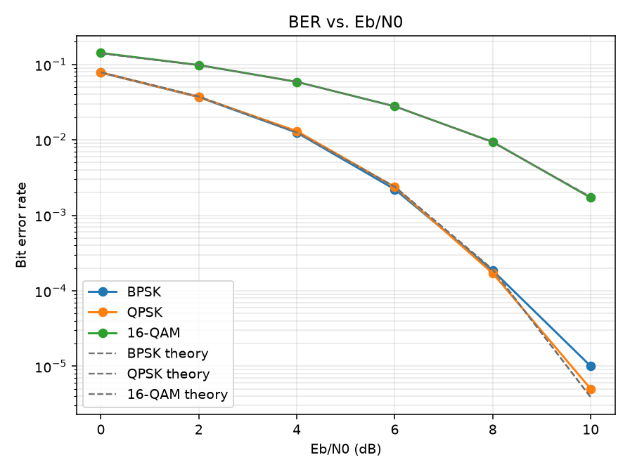</a> | <a href="../examples/figures/soft_decision.png">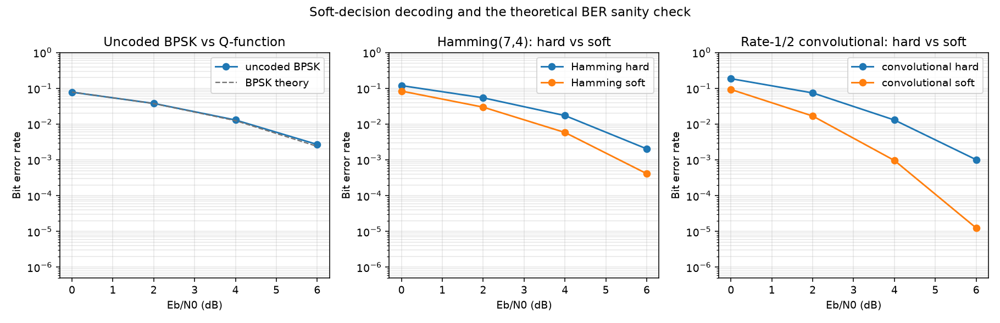</a> |
| <sub><b>Figure 1.</b> Uncoded BPSK, QPSK, and 16-QAM against the closed-form references. The dashed curves are theory, not fits.</sub> | <sub><b>Figure 2.</b> Hamming(7,4), tau-invariant RM(1,3) with the FHT, and rate-1/2 convolutional decoding: hard decisions versus LLRs. The convolutional soft curve is the main coding gain.</sub> |

| Interleaver under bursts | Block Rayleigh |
|---|---|
| <a href="../examples/figures/interleaver.png">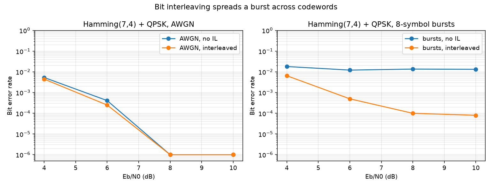</a> | <a href="../examples/figures/rayleigh.png">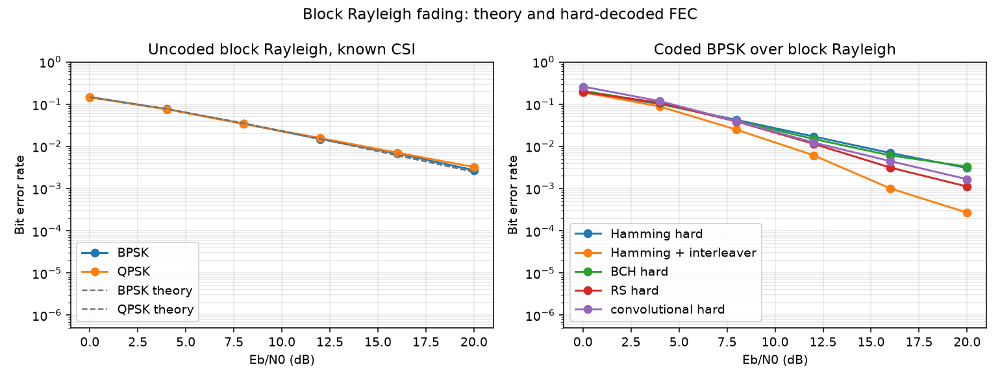</a> |
| <sub><b>Figure 3.</b> Hamming + QPSK with and without a bit interleaver. AWGN is the control; the 8-symbol burst case shows the gain.</sub> | <sub><b>Figure 4.</b> Block Rayleigh with known CSI: uncoded BPSK/QPSK against theory, and Hamming/BCH/RS/convolutional hard decoding.</sub> |

| BCH, RS, and convolutional codes | TCM 8-PSK versus QPSK |
|---|---|
| <a href="../examples/figures/bch_rs.png">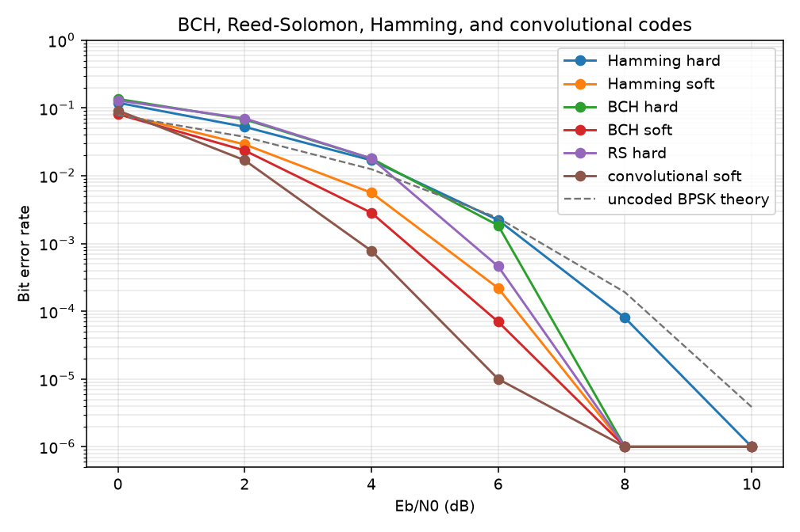</a> | <a href="../examples/figures/tcm.png">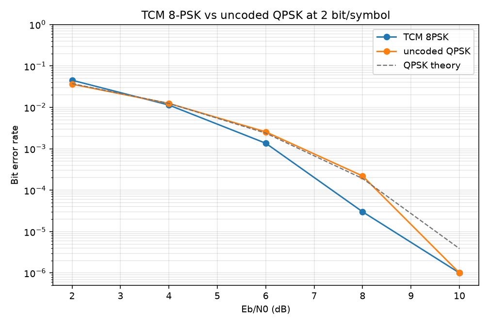</a> |
| <sub><b>Figure 5.</b> BCH(15,7), RS(15,11), Hamming(7,4), and convolutional coding over AWGN. BCH and Hamming use soft ML; RS is hard-decoded.</sub> | <sub><b>Figure 6.</b> Four-state rate-2/3 TCM 8-PSK against uncoded QPSK at the same 2 bit/symbol spectral efficiency.</sub> |

---

## Radio, waveforms, and trellis examples

| Wideband squint | Phase quantisation |
|---|---|
| <a href="../examples/figures/beam_squint.png">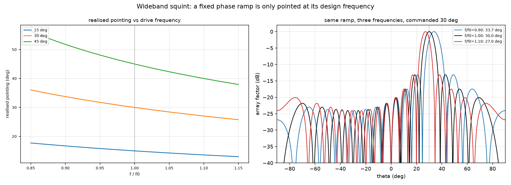</a> | <a href="../examples/figures/phase_quantization.png">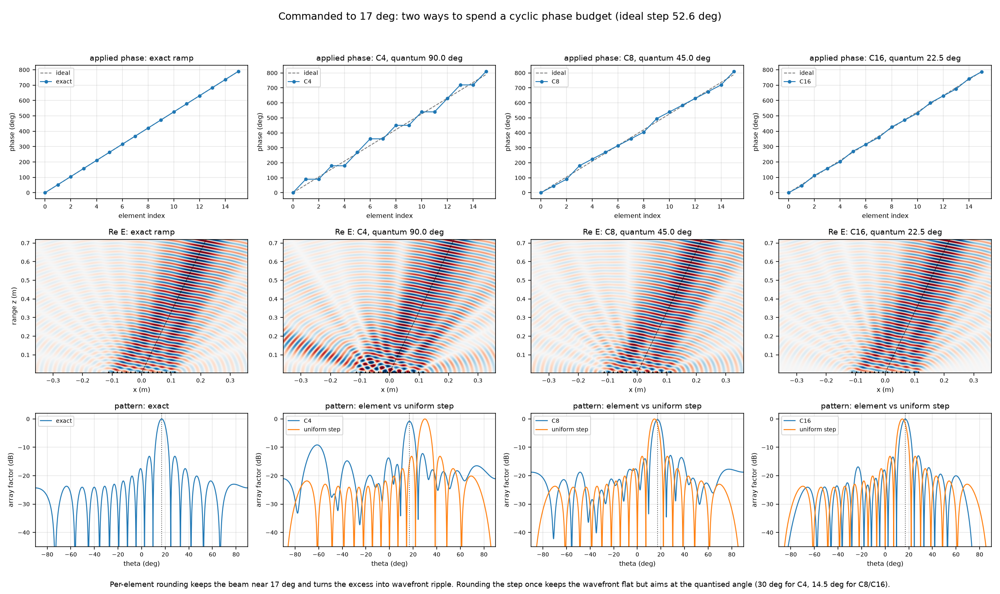</a> |
| <sub><b>Figure 7.</b> Wideband squint: a fixed phase ramp points at its design frequency only.</sub> | <sub><b>Figure 8.</b> C4/C8/C16 phase quantisation at 17 degrees: per-element rounding versus a uniform step.</sub> |

The APSK/tail-biting/shaping examples are code-first and do not currently emit
a dedicated figure; see `examples/explore_cyclic_structures.py`.

---

## Phased arrays and quantum frequency conversion

| Wavefront steering | QFC transport and noise |
|---|---|
| <a href="../examples/figures/wavefront_steering.png">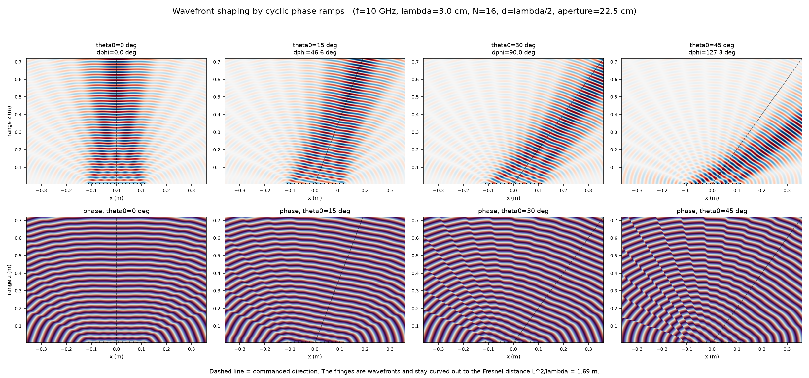</a> | <a href="../examples/figures/qfc_transport.png">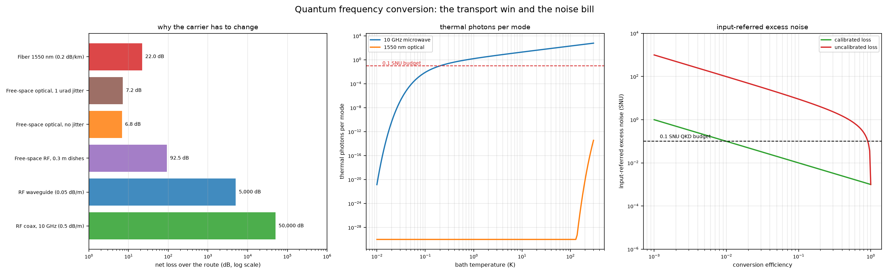</a> |
| <sub><b>Figure 9.</b> Near-field wavefronts for exact phase ramps on a linear array.</sub> | <sub><b>Figure 10.</b> 100 km transport loss, thermal photons, and the transduction excess-noise budget.</sub> |

<p align="center">
  <a href="../examples/figures/qfc_state.png">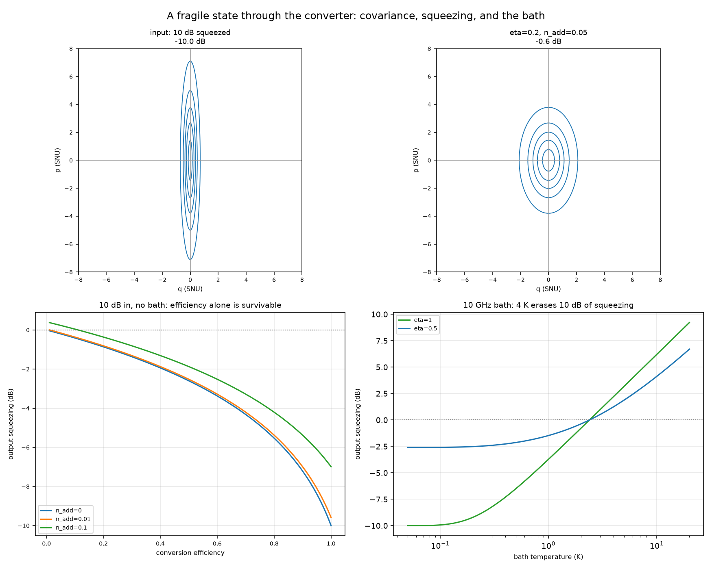</a>
</p>
<p align="center"><sub><b>Figure 11.</b> A squeezed state through the converter: Wigner contours, surviving squeezing, and the thermal floor.</sub></p>

---

## Coding, number theory, and exploratory index modulation

| CRC detection | QC-MDPC matrix |
|---|---|
| <a href="../examples/figures/crc_encoding.png">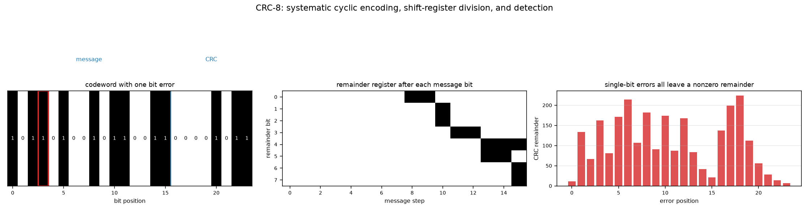</a> | <a href="../examples/figures/qc_mdpc_matrix.png">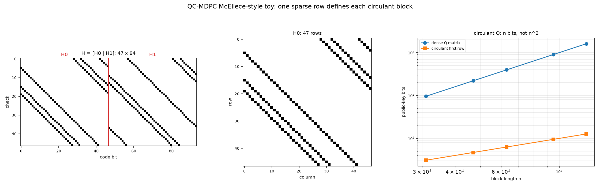</a> |
| <sub><b>Figure 12.</b> CRC-8 frame with one error, the remainder-register trace, and the nonzero remainder left by each single-bit error.</sub> | <sub><b>Figure 13.</b> The toy QC-MDPC check `H = [H0 | H1]` and the linear key-size scaling of a circulant block.</sub> |

<p align="center">
  <a href="../examples/figures/qc_mdpc_decoding.png">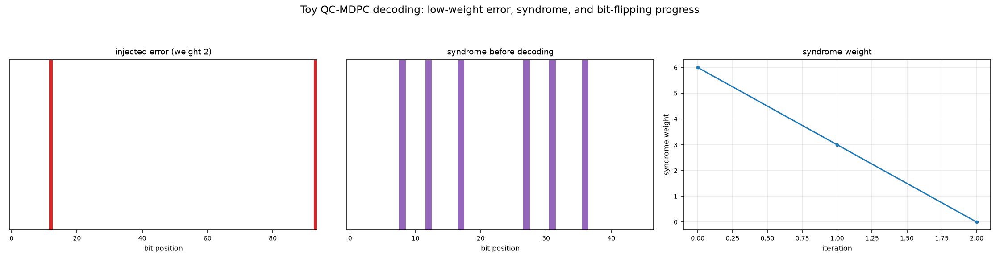</a>
</p>
<p align="center"><sub><b>Figure 14.</b> A weight-two QC-MDPC error and the syndrome weight falling to zero during bit-flipping.</sub></p>

<p align="center">
  <a href="../examples/figures/qc_mdpc_security.png">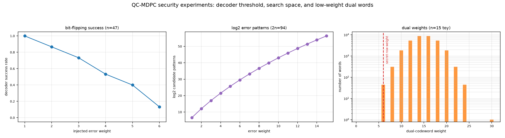</a>
</p>
<p align="center"><sub><b>Figure 15.</b> Toy QC-MDPC security experiments: decoder success, syndrome search space, and dual-code low-weight spectrum.</sub></p>

<p align="center">
  <a href="../examples/figures/residual_index_density.png">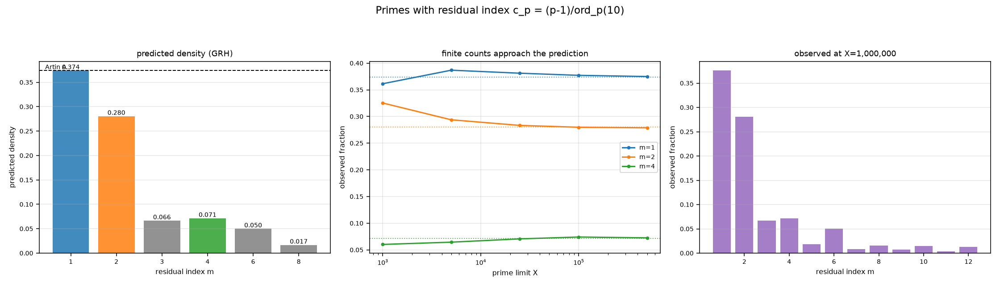</a>
</p>
<p align="center"><sub><b>Figure 16.</b> Residual-index densities for base 10: GRH predictions, finite-count convergence, and the observed histogram.</sub></p>

<p align="center">
  <a href="../examples/figures/ct_im_codebook.png">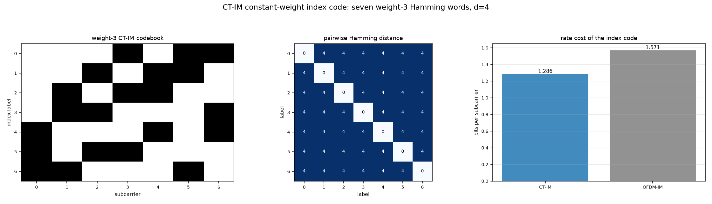</a>
</p>
<p align="center"><sub><b>Figure 17.</b> The CT-IM weight-3 Hamming orbit, pairwise distances, and the rate cost against classical OFDM-IM.</sub></p>

<p align="center">
  <a href="../examples/figures/phase_imbalance.png">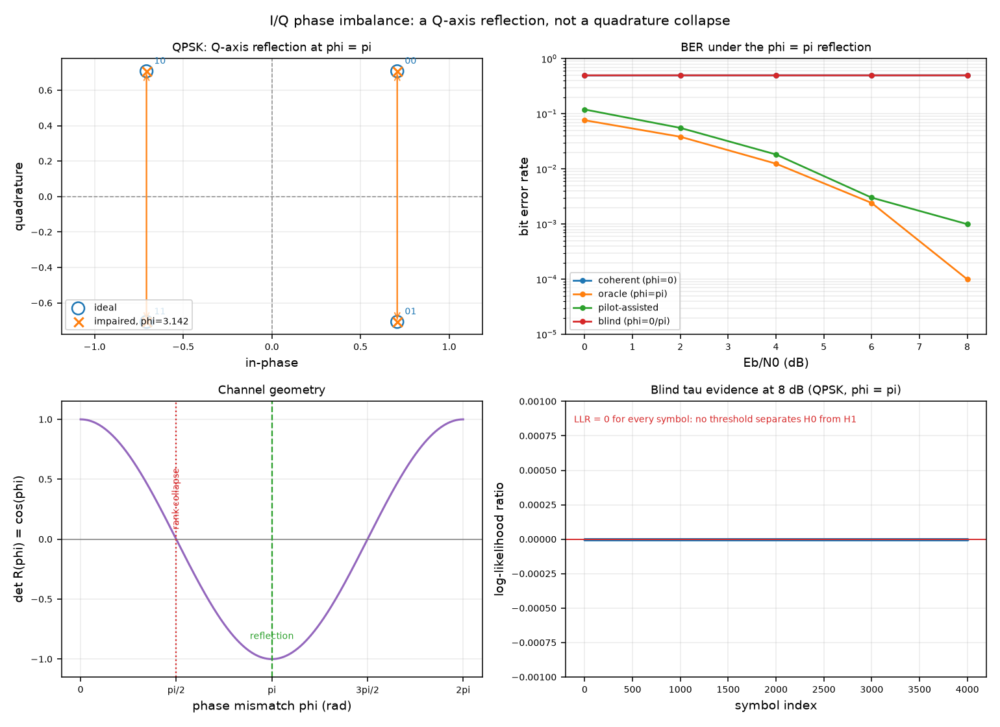</a>
</p>
<p align="center"><sub><b>Figure 18.</b> The I/Q reflection at phi = pi, hard/oracle/pilot/blind BER, the channel determinant, and the identically zero blind LLR.</sub></p>

<p align="center">
  <a href="../examples/figures/lattice.png">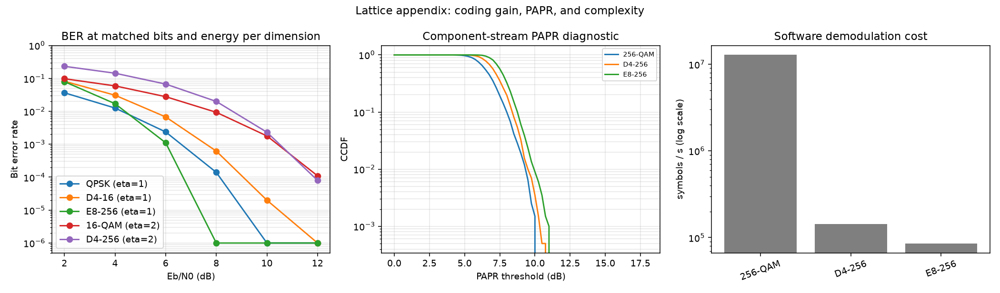</a>
</p>
<p align="center"><sub><b>Figure 19.</b> Lattice appendix: dimension-matched BER, component-stream PAPR diagnostic, and naive software demodulation cost.</sub></p>

<p align="center">
  <a href="../examples/figures/ldpc.png">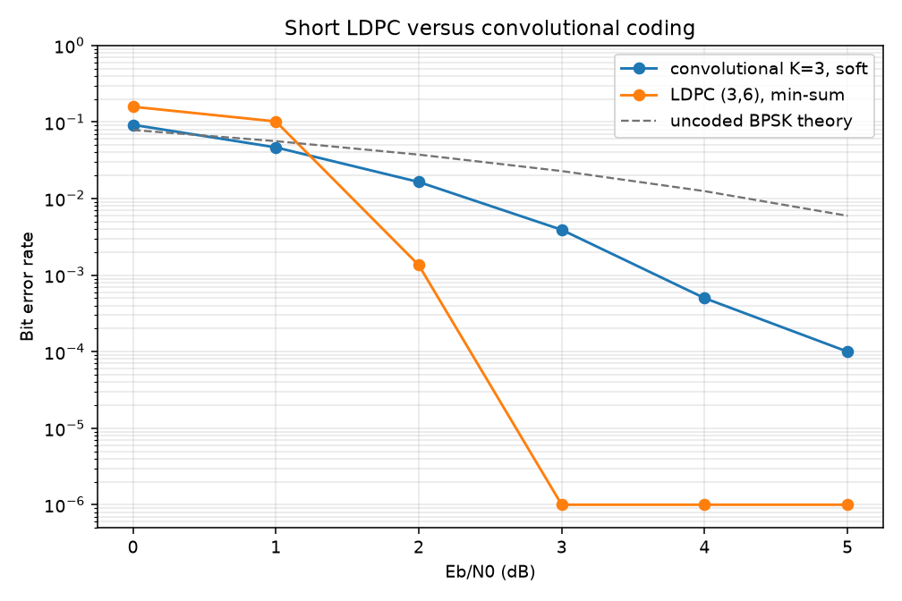</a>
</p>
<p align="center"><sub><b>Figure 20.</b> Short LDPC(1008,506) with normalized min-sum versus the K=3 convolutional code, plus uncoded BPSK theory.</sub></p>

<p align="center">
  <a href="../examples/figures/polar.png">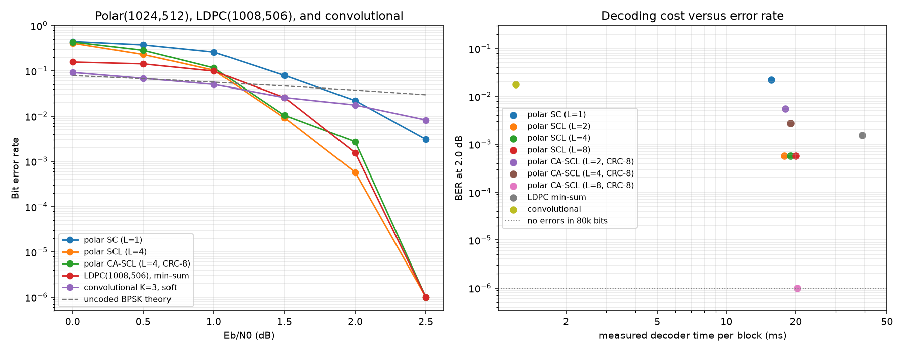</a>
</p>
<p align="center"><sub><b>Figure 21.</b> Polar(1024,512): successive cancellation, list decoding, and CRC-aided list decoding, with the measured decoder time per block on the right.</sub></p>

<p align="center">
  <a href="../examples/figures/tau_invariant.png">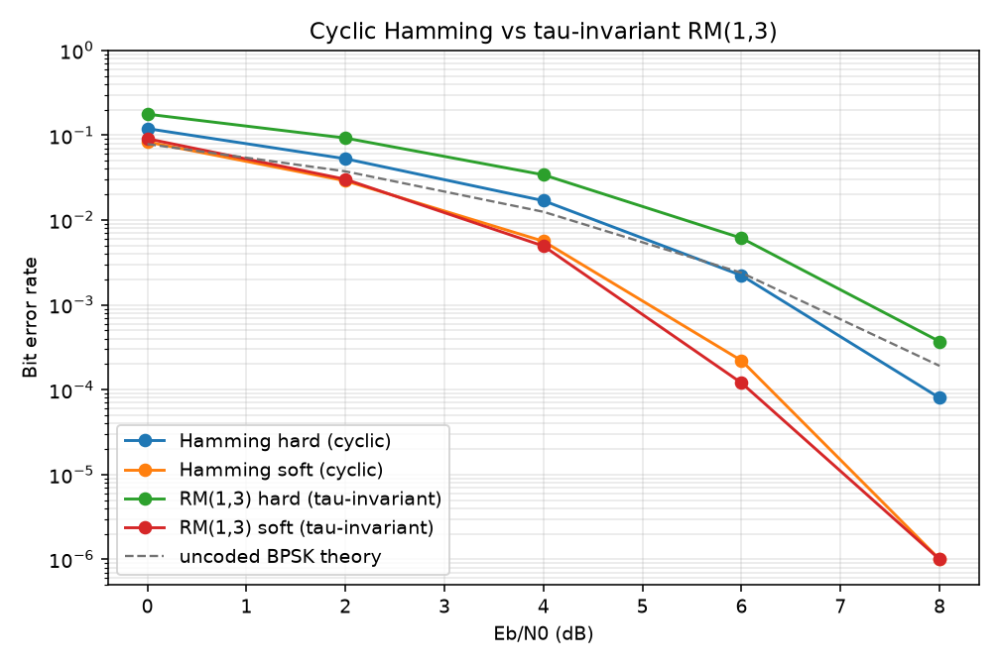</a>
</p>
<p align="center"><sub><b>Figure 22.</b> Cyclic Hamming(7,4) versus tau-invariant RM(1,3): similar soft-decision gain, different symmetry class.</sub></p>

---

## Legacy scratch-lab outputs

These are retained for provenance from `src/modcode/cyclic-5g/`; the
maintained implementations are `modcode.phasedarray` and `modcode.qfc`.

| Legacy wavefront | Legacy quantisation |
|---|---|
| <a href="../src/modcode/cyclic-5g/figures/wavefront_steering.png">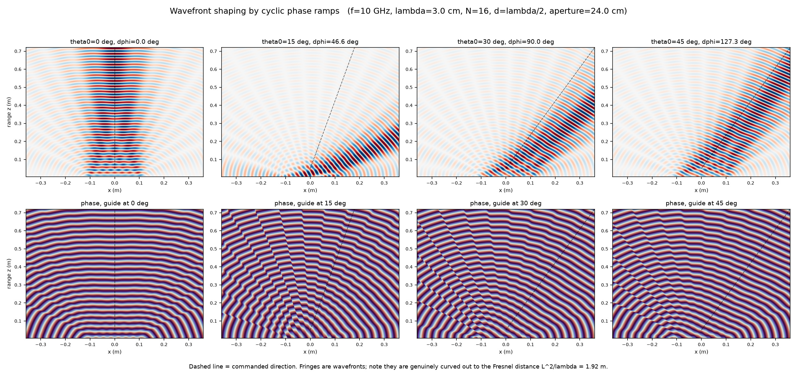</a> | <a href="../src/modcode/cyclic-5g/figures/quantization_error.png">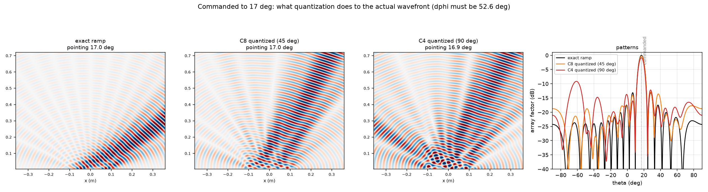</a> |
| <sub><b>Figure 23.</b> Original scratch-lab wavefront figure.</sub> | <sub><b>Figure 24.</b> Original scratch-lab C4/C8 quantisation comparison.</sub> |

| Legacy QFC | Legacy beam patterns |
|---|---|
| <a href="../src/modcode/cyclic-5g/figures/qfc_transduction.png">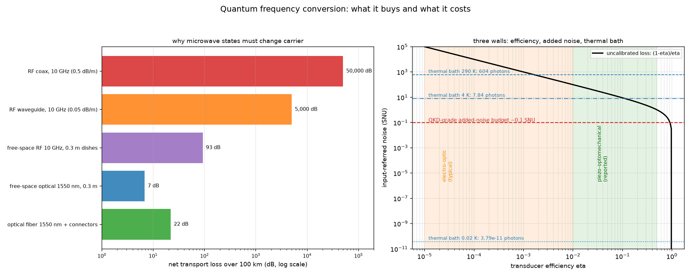</a> | <a href="../src/modcode/cyclic-5g/figures/beam_patterns.png">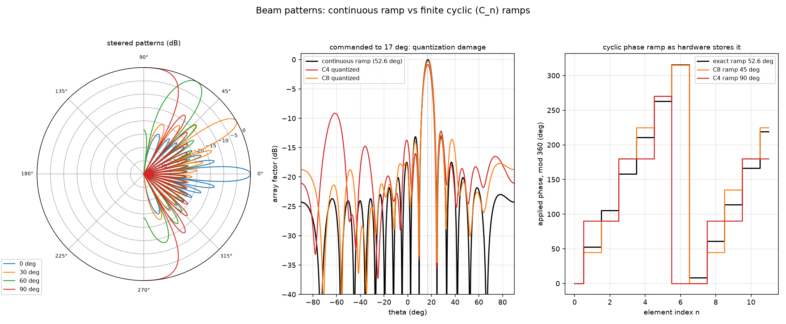</a> |
| <sub><b>Figure 25.</b> Original QFC transport and noise figure.</sub> | <sub><b>Figure 26.</b> Original polar beam patterns and phase ramps.</sub> |

---

## Regenerate

```bash
python examples/run_ber_sweep.py
python examples/soft_decision_lab.py
python examples/interleaver_lab.py
python examples/fading_lab.py
python examples/bch_rs_lab.py
python examples/ldpc_lab.py
python examples/polar_lab.py
python examples/tcm_lab.py
python examples/wavefront_qfc_lab.py
python examples/cyclic_codes_pqc_lab.py
python examples/residual_index_lab.py
python examples/ct_im_lab.py
python examples/phase_imbalance_lab.py
python examples/lattice_lab.py
python examples/tau_invariant_lab.py
```
